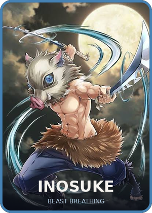
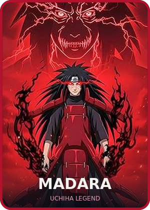

<!-- ========================================= -->
<!-- ATHRAV KHANDELWAL | ANIME DEVELOPER PROFILE -->
<!-- ========================================= -->

<!-- DEATH NOTE ANIME HEADER -->

<!-- TYPING ANIMATION -->

 

<!-- ============ ABOUT ME ============ -->

 

AI/ML student from Pune. I build **full-stack web apps** and **AI-powered projects**, and I'm going deeper into Machine Learning, Deep Learning and Generative AI.

> **Learn deeply. Build meaningfully.**

 

<!-- ============ PROJECTS ============ -->

 

| PROJECT | WHAT IT DOES | STACK |
|:---|:---|:---|
| [**EduSync**](https://github.com/aiml-athrav/EduSync-smart-attendance-system-) | Full-stack attendance management system with separate Student, Teacher and Admin portals | Node.js · Express · MongoDB · Tailwind |
| [**memeLearn**](https://github.com/aiml-athrav/memeLearn) | AI-powered educational meme platform, built for a hackathon | TypeScript |
| [**Credit Card Fraud Detection**](https://github.com/aiml-athrav/credit-card-fraud-detection) | Machine learning model that flags fraudulent card transactions | Python |
| [**GARUD**](https://github.com/aiml-athrav/GARUD) | ✏️ *Write one line here: what does GARUD actually do?* | JavaScript |
| [**Automated Customer Service Bots**](https://github.com/aiml-athrav/Automated-customer-service-bots) | Automated customer service bots | JavaScript |
| [**Portfolio**](https://github.com/aiml-athrav/athrav_portfolio) | Personal portfolio website | HTML |

 

<!-- ============ WEAPONS ============ -->

 

**PROGRAMMING LANGUAGES**

**TOOLS AND TECHNOLOGIES**

 

<!-- ============ TRAINING ARC ============ -->

 

 

<!-- ============ SQUAD ============ -->

 

**Five characters. Five mindsets. One developer journey.**

<table>
<tr>
<td align="center" width="20%">

 <b>Jin-Woo</b> Level up every day
</td>

<td align="center" width="20%">

 <b>Sukuna</b> Ship big projects
</td>

<td align="center" width="20%">

 <b>Tanjiro</b> Stay consistent
</td>

<td align="center" width="20%">

 <b>Inosuke</b> Break bugs head-on
</td>

<td align="center" width="20%">

 <b>Madara</b> Think long-term
</td>
</tr>
</table>

 

<!-- ============ POWER LEVEL ============ -->

 

  

 

**"ARISE." — Keep Leveling Up.**

ATHRAV KHANDELWAL · AI / ML DEVELOPER IN PROGRESS

