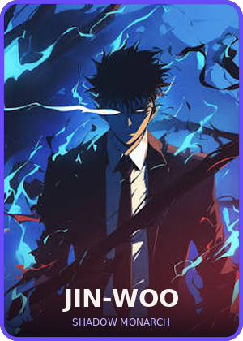
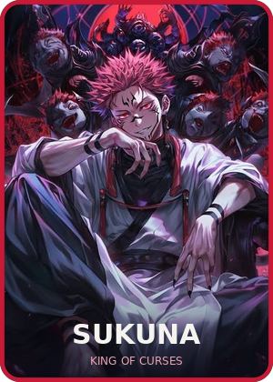
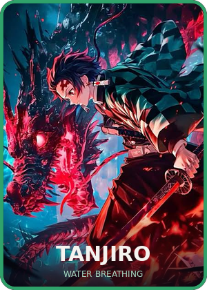

<!-- ========================================= -->
<!-- ATHRAV KHANDELWAL | ANIME DEVELOPER PROFILE -->
<!-- ========================================= -->

<div align="center">

<!-- CRIMSON APPLE DEMON BACKGROUND -->


<br/>

<!-- TYPING ANIMATION -->


<br/>

📍 Pune, India · 🎓 B.Tech in Artificial Intelligence & Machine Learning

<br/>

<a href="https://github.com/aiml-athrav">

</a>

<a href="https://linkedin.com/in/athravkhandelwal1230">

</a>

</div>

---

## ⚔️ MY SQUAD

**Five characters. Five different personalities. One developer journey.**

<div align="center">

<table>
<tr>
<td align="center" width="20%">

<sub>keep levelling up</sub>
</td>

<td align="center" width="20%">

<sub>Ship big projects</sub>
</td>

<td align="center" width="20%">

<sub>Stay consistent</sub>
</td>

<td align="center" width="20%">

<sub>Break bugs head-on	</sub>
</td>

<td align="center" width="20%">

<sub>Think long-term</sub>
</td>
</tr>
</table>

</div>

---

## 🗡️ 01 — SHADOW MONARCH: ABOUT ME

I'm Athrav Khandelwal, an AI/ML student passionate about technology, programming and building intelligent systems.

I enjoy exploring new technologies, solving problems and turning ideas into practical projects.

```python
class Athrav:

    name = "Athrav Khandelwal"
    role = "AI / ML Student"

    currently_learning = [
        "Python",
        "C++",
        "Data Structures & Algorithms",
        "Machine Learning"
    ]

    exploring = [
        "Deep Learning",
        "Generative AI",
        "LLM Applications",
        "Open Source"
    ]

    goal = "Build meaningful AI-powered solutions"

    philosophy = "Learn deeply. Build meaningfully."
```

---

## 🧠 02 — TRAINING ARC

<div align="center">


</div>

| Training Arc 📚 | Next Arc 🔭 |
|:---|:---|
| Python | Deep Learning |
| C++ | Generative AI |
| DSA | LLM Applications |
| Machine Learning | Open Source |

> Learn deeply. Build meaningfully.

---

## 🛠️ 03 — WEAPONS & TECHNOLOGY

<div align="center">

**PROGRAMMING LANGUAGES**


<br/><br/>

**TOOLS & TECHNOLOGIES**


</div>

---

## 👑 04 — DOMAIN EXPANSION: PROJECTS

<div align="center">

| PROJECT | DESCRIPTION |
|:---|:---|
| [GARUD](https://github.com/aiml-athrav/GARUD) | AI-focused development project |
| [Smart Attendance System](https://github.com/aiml-athrav/smart-attendance-system) | Smart attendance management project |
| [Credit Card Fraud Detection](https://github.com/aiml-athrav/credit-card-fraud-detection) | Machine learning project |
| [memeLearn](https://github.com/aiml-athrav/memeLearn) | Learning-focused development project |
| [Portfolio](https://github.com/aiml-athrav/athrav_portfolio) | Personal portfolio website |

<br/>

<a href="https://github.com/aiml-athrav?tab=repositories">

</a>

</div>

---

## 🔥 05 — THE CHARACTER PHILOSOPHY

<div align="center">

| CHARACTER | DEVELOPER MINDSET |
|:---:|:---|
| ⚔️ Jin-Woo | Level up every day |
| 🔥 Sukuna | Build with confidence |
| 🌊 Tanjiro | Stay consistent |
| 🐗 Inosuke | Face challenges directly |
| 👁️ Madara | Think long-term |

</div>

---

## 📊 06 — POWER LEVEL

<div align="center">


<br/><br/>


</div>

---

## 🌌 CONNECT WITH ME

<div align="center">

<a href="https://github.com/aiml-athrav">

</a>

<a href="https://linkedin.com/in/athravkhandelwal1230">

</a>

<br/><br/>


**"ARISE." — Keep Leveling Up.**

<sub>ATHRAV KHANDELWAL · AI / ML DEVELOPER IN PROGRESS</sub>

</div>
